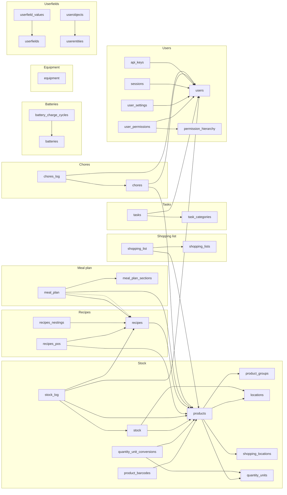

# Grocy v4.7.1 data model and master data

This file answers GitHub issue #35. It maps the tables of Grocy v4.7.1, the
references between them, and the clusters they form. Then it answers the
master data question. The grilling ticket "Break Grocy Next into subdomains"
(issue #30) uses this file to draw the subdomain boundaries.

This file contains no Grocy source code. It describes only.

The earlier survey (`docs/research/grocy-survey.md` on the branch
`research/grocy-survey`) lists the pages, the API operations, and the entity
types of each area. This file does not repeat that list.

## Sources

| Source | Location in the Grocy repo at tag `v4.7.1` | What it gives |
| --- | --- | --- |
| Migrations | `migrations/0001.sql` to `migrations/0257.sql`, `migrations/0027.php`, `migrations/8888.php` | Every table, view, trigger, index, and seed row. |
| Sidebar menu | `views/layout/default.blade.php` | The menu items and the "Manage master data" group. |
| Generic entity API | `controllers/Api/GenericEntityApiController.php` | Which permission each entity write needs. |
| Services | `services/StockService.php`, `ChoresService.php`, `BatteriesService.php`, `RecipesService.php`, `UsersService.php`, `SessionService.php`, `ApiKeyService.php`, `UserfieldsService.php` | Which service writes which table outside the generic entity API. |
| Browser code | `public/viewjs/*.js` | Which pages write through the generic entity API. |
| OpenAPI spec | `grocy.openapi.json` (a copy is at `docs/reference/grocy-openapi.json` in this repo) | The `ExposedEntity` enums that mark an entity as read-only. |
| Permissions | `migrations/0110.sql`, `controllers/Users/User.php` | The permission tree and the `MASTER_DATA_EDIT` permission. |

Repo URL: <https://github.com/grocy/grocy/tree/v4.7.1>

## Method

Grocy builds its SQLite database from numbered migration files. The migration
service runs the files in number order. To get the final schema, I ran the 257
SQL files in order into an empty SQLite file and read the result. The two PHP
migrations do not change the schema: `0027.php` creates the first user,
`8888.php` makes sure that a location with id 1 exists when location tracking
is off.

Counts in the final schema:

| Object | Count |
| --- | --- |
| Tables | 36, plus the `migrations` table that the migration service creates |
| Views | 45 |
| Triggers | 57 |
| Indexes (not counting the automatic primary key and unique indexes) | 12 |

## Finding 1: Grocy declares no foreign keys

No migration contains a `REFERENCES` clause. Every reference between tables is
a convention: an integer column named `<something>_id` holds the `id` of a row
in another table, or a text column holds a key that another table also holds.
SQLite does not check these references. Grocy keeps them consistent with
triggers, with code in the services, and with the UI forms.

Three kinds of reference exist:

| Kind | How it works | Example |
| --- | --- | --- |
| Id reference | An integer column holds the `id` of a row in another table. | `stock.product_id` holds a `products.id`. |
| Text key | A text column holds a generated key. Rows in two tables share it. | `stock.stock_id` and `stock_log.stock_id` share the key of one stock entry. |
| Name reference | A text column holds the name of an entity, not an id. | `userfields.entity` holds `products` or `userentity-<name>`. |

## Finding 2: the tables and their references

The table below lists every table, the cluster it belongs to, and each column
that references another table. "NOT NULL" means the schema requires a value.
The glossary terms apply: a row in `stock` is a stock entry, a row in
`stock_log` is a booking, and rows that share a `transaction_id` form a
transaction.

### Cluster: Stock

| Table | Column | References | Notes |
| --- | --- | --- | --- |
| `products` | `location_id` | `locations.id` | NOT NULL. The default location. |
| `products` | `default_consume_location_id` | `locations.id` | |
| `products` | `shopping_location_id` | `shopping_locations.id` | The default store. |
| `products` | `product_group_id` | `product_groups.id` | |
| `products` | `qu_id_stock`, `qu_id_purchase` | `quantity_units.id` | NOT NULL. |
| `products` | `qu_id_consume`, `qu_id_price` | `quantity_units.id` | A trigger copies `qu_id_stock` and `qu_id_purchase` into these when empty. |
| `products` | `parent_product_id` | `products.id` | Self reference. A trigger permits one level only and rejects a self reference. |
| `product_barcodes` | `product_id` | `products.id` | NOT NULL. A trigger rejects a barcode for a product that does not exist. The pair (`barcode`, `product_id`) is unique. |
| `product_barcodes` | `qu_id` | `quantity_units.id` | A trigger copies the product purchase unit when empty. |
| `product_barcodes` | `shopping_location_id` | `shopping_locations.id` | |
| `quantity_unit_conversions` | `from_qu_id`, `to_qu_id` | `quantity_units.id` | NOT NULL. |
| `quantity_unit_conversions` | `product_id` | `products.id` | Empty means a general conversion. A trigger rejects a duplicate pair for the same product. |
| `stock` | `product_id` | `products.id` | NOT NULL. A trigger rejects a product that has `no_own_stock`. |
| `stock` | `location_id` | `locations.id` | A trigger copies the product default location when empty. |
| `stock` | `shopping_location_id` | `shopping_locations.id` | |
| `stock` | `stock_id` | text key | NOT NULL. Generated per stock entry. Shared with `stock_log`. |
| `stock_log` | `product_id` | `products.id` | NOT NULL. |
| `stock_log` | `location_id` | `locations.id` | A trigger copies the product default location when empty. |
| `stock_log` | `shopping_location_id` | `shopping_locations.id` | |
| `stock_log` | `recipe_id` | `recipes.id` | Set when a recipe consume creates the booking. |
| `stock_log` | `user_id` | `users.id` | NOT NULL. The user who made the booking. |
| `stock_log` | `stock_row_id` | `stock.id` | The stock entry row that the booking changed. |
| `stock_log` | `stock_id` | text key | NOT NULL. The stock entry key. |
| `stock_log` | `transaction_id` | text key | Groups the bookings of one transaction. |
| `stock_log` | `correlation_id` | text key | Groups the transactions of one user action. |
| `cache__products_average_price` | `product_id` | `products.id` | Unique. Triggers on `stock_log` fill this table. |
| `cache__products_last_purchased` | `product_id` | `products.id` | Unique. Triggers on `stock_log` fill this table. |
| `cache__products_last_purchased` | `location_id`, `shopping_location_id` | `locations.id`, `shopping_locations.id` | |
| `cache__quantity_unit_conversions_resolved` | `product_id`, `from_qu_id`, `to_qu_id` | `products.id`, `quantity_units.id` | Triggers on `products` and `quantity_unit_conversions` fill this table. |
| `locations` | none | | |
| `shopping_locations` | none | | Grocy's UI calls these "Stores". |
| `product_groups` | none | | |
| `quantity_units` | none | | |

### Cluster: Shopping list

| Table | Column | References | Notes |
| --- | --- | --- | --- |
| `shopping_lists` | none | | Migration `0062.sql` seeds one list named "Default" with id 1. |
| `shopping_list` | `shopping_list_id` | `shopping_lists.id` | Default 1. One row is one item. |
| `shopping_list` | `product_id` | `products.id` | Empty means a free-text item. |
| `shopping_list` | `qu_id` | `quantity_units.id` | A trigger copies the product purchase unit when empty. |

### Cluster: Recipes

| Table | Column | References | Notes |
| --- | --- | --- | --- |
| `recipes` | `product_id` | `products.id` | Only for rows of type `mealplan-shadow`. The `type` column holds `normal`, `mealplan-day`, `mealplan-week`, or `mealplan-shadow`. |
| `recipes_pos` | `recipe_id` | `recipes.id` | NOT NULL. One row is one ingredient. |
| `recipes_pos` | `product_id` | `products.id` | NOT NULL. |
| `recipes_pos` | `qu_id` | `quantity_units.id` | A trigger copies the product stock unit when empty and rejects a unit with no conversion for the product. |
| `recipes_nestings` | `recipe_id`, `includes_recipe_id` | `recipes.id` | NOT NULL. The pair is unique. Triggers reject a self reference and a loop. |

### Cluster: Meal plan

| Table | Column | References | Notes |
| --- | --- | --- | --- |
| `meal_plan` | `recipe_id` | `recipes.id` | For rows of type `recipe`. The pair (`day`, `recipe_id`) is unique. |
| `meal_plan` | `product_id` | `products.id` | For rows of type `product`. |
| `meal_plan` | `product_qu_id` | `quantity_units.id` | |
| `meal_plan` | `section_id` | `meal_plan_sections.id` | NOT NULL. Default -1. |
| `meal_plan_sections` | none | | Migration `0149.sql` seeds a hidden section with id -1 and an empty name. A trigger rejects its deletion. |

The meal plan writes into the Recipes cluster. Triggers on `meal_plan` create,
update, and delete one internal recipe per planned day (type `mealplan-day`),
one per week (type `mealplan-week`), and one per planned product (type
`mealplan-shadow`). They link these with rows in `recipes_nestings` and
`recipes_pos`. The internal recipes get negative ids. The recipe fulfillment
views then work for a day or a week in the same way as for a normal recipe.

### Cluster: Chores

| Table | Column | References | Notes |
| --- | --- | --- | --- |
| `chores` | `next_execution_assigned_to_user_id` | `users.id` | |
| `chores` | `rescheduled_next_execution_assigned_to_user_id` | `users.id` | |
| `chores` | `assignment_config` | `users.id`, as text | A comma-separated list of user ids. |
| `chores` | `product_id` | `products.id` | The product to consume on execution. The column type is `TINYINT`. SQLite stores any integer in it. |
| `chores_log` | `chore_id` | `chores.id` | NOT NULL. One row is one execution. |
| `chores_log` | `done_by_user_id` | `users.id` | |

### Cluster: Tasks

| Table | Column | References | Notes |
| --- | --- | --- | --- |
| `tasks` | `category_id` | `task_categories.id` | |
| `tasks` | `assigned_to_user_id` | `users.id` | |
| `task_categories` | none | | |

### Cluster: Batteries

| Table | Column | References | Notes |
| --- | --- | --- | --- |
| `batteries` | none | | |
| `battery_charge_cycles` | `battery_id` | `batteries.id` | NOT NULL. One row is one charge. |

### Cluster: Equipment

| Table | Column | References | Notes |
| --- | --- | --- | --- |
| `equipment` | `instruction_manual_file_name` | a file on disk | The file is in the file group `equipmentmanuals`. No table reference. |

### Cluster: Users

| Table | Column | References | Notes |
| --- | --- | --- | --- |
| `users` | none | | Migration `0027.php` creates the first user: `admin` with password `admin`, or the user from the old config file. |
| `user_permissions` | `user_id` | `users.id` | NOT NULL. The pair (`user_id`, `permission_id`) is unique. |
| `user_permissions` | `permission_id` | `permission_hierarchy.id` | NOT NULL. |
| `permission_hierarchy` | `parent` | `permission_hierarchy.id` | Self reference. Migration `0110.sql` seeds the full tree. The root is `ADMIN`. |
| `user_settings` | `user_id` | `users.id` | NOT NULL. The pair (`user_id`, `key`) is unique. |
| `sessions` | `user_id` | `users.id` | NOT NULL. |
| `api_keys` | `user_id` | `users.id` | NOT NULL. The `key_type` column holds `default` or `special-purpose-calendar-ical`. |

### Cluster: Userfields

| Table | Column | References | Notes |
| --- | --- | --- | --- |
| `userfields` | `entity` | an entity name, as text | Any name in the `ExposedEntity` enum, `users`, or `userentity-<name>` for a user entity. The pair (`entity`, `name`) is unique. |
| `userfield_values` | `field_id` | `userfields.id` | NOT NULL. The pair (`field_id`, `object_id`) is unique. |
| `userfield_values` | `object_id` | the `id` of a row in the entity, as text | For the entity `stock`, a trigger replaces the transaction id with the `stock_id` text key, so the value follows the stock entry. |
| `userentities` | none | | A user-defined entity. It gets its own sidebar menu item. |
| `userobjects` | `userentity_id` | `userentities.id` | NOT NULL. A row has no own columns. All its data is in `userfield_values`. |

### Files

Four columns hold file names, not table references: `products.picture_file_name`,
`recipes.picture_file_name`, `users.picture_file_name`, and
`equipment.instruction_manual_file_name`. Grocy stores the files on disk in
the file groups `productpictures`, `recipepictures`, `userpictures`,
`equipmentmanuals`, and `userfiles` (for userfields of the type file).

## Finding 3: the triggers that keep the references consistent

Grocy has no foreign key cascades. Triggers do that work. The table below lists
the triggers that delete or change rows in other tables.

| Event | What the trigger does |
| --- | --- |
| Delete a product | Deletes its stock entries, bookings, barcodes, conversions, recipe ingredients, meal plan product rows, shopping list items, and userfield values. Clears `recipes.product_id` where it pointed at the product. |
| Delete a chore | Deletes its executions and its userfield values. |
| Delete a battery | Deletes its charge cycles and its userfield values. |
| Delete a quantity unit | Deletes the conversions that use it. |
| Delete a shopping list | Deletes its items. |
| Delete a recipe | Deletes the meal plan rows that use it. |
| Delete a userfield | Deletes its values. |
| Delete a meal plan section with id -1 | Rejected. |
| Insert, update, or delete a meal plan row | Rebuilds the internal day, week, and shadow recipes and their nestings and ingredients. |
| Change a product's stock unit | Rejected when the product was ever in stock and no conversion exists. Otherwise converts the amounts in chores, meal plan, recipe ingredients, shopping list items, stock entries, and bookings. |
| Insert or update a booking | Refreshes the two price cache tables for that product. |
| Insert or update a product or a conversion | Refreshes the resolved conversion cache for that product. |

No trigger cleans up after the deletion of a location, a store, a product
group, a task category, a user, a user entity, or a recipe ingredient.
Rows that point at a deleted row of these tables keep the old id.

## Finding 4: the entity dependency graph

### As a table

One row per cluster. "Depends on" lists the clusters that this cluster's
tables reference. "Referenced by" lists the clusters whose tables reference
this cluster. A reference is a column from the tables above.

| Cluster | Tables | Depends on | Referenced by |
| --- | --- | --- | --- |
| Stock | `products`, `product_barcodes`, `product_groups`, `locations`, `shopping_locations`, `quantity_units`, `quantity_unit_conversions`, `stock`, `stock_log`, three `cache__` tables | Users (`stock_log.user_id`), Recipes (`stock_log.recipe_id`) | Shopping list, Recipes, Meal plan, Chores, Userfields |
| Shopping list | `shopping_lists`, `shopping_list` | Stock (`product_id`, `qu_id`) | Userfields |
| Recipes | `recipes`, `recipes_pos`, `recipes_nestings` | Stock (`product_id`, `qu_id`) | Meal plan, Stock (`stock_log.recipe_id`), Userfields |
| Meal plan | `meal_plan`, `meal_plan_sections` | Recipes (`recipe_id`), Stock (`product_id`, `product_qu_id`) | Userfields. Also writes Recipes through triggers. |
| Chores | `chores`, `chores_log` | Users (assigned and done-by user), Stock (`chores.product_id`) | Userfields |
| Tasks | `tasks`, `task_categories` | Users (`assigned_to_user_id`) | Userfields |
| Batteries | `batteries`, `battery_charge_cycles` | none | Userfields |
| Equipment | `equipment` | none | Userfields |
| Users | `users`, `user_permissions`, `permission_hierarchy`, `user_settings`, `sessions`, `api_keys` | none | Stock, Chores, Tasks, Userfields |
| Userfields | `userfields`, `userfield_values`, `userentities`, `userobjects` | Every cluster, by entity name and object id | none |

Cross-cluster references, counted by column:

| From cluster | To cluster | Columns |
| --- | --- | --- |
| Shopping list | Stock | 2 |
| Recipes | Stock | 3 (`recipes.product_id`, `recipes_pos.product_id`, `recipes_pos.qu_id`) |
| Meal plan | Recipes | 1 |
| Meal plan | Stock | 2 |
| Stock | Recipes | 1 (`stock_log.recipe_id`) |
| Stock | Users | 1 (`stock_log.user_id`) |
| Chores | Users | 3 |
| Chores | Stock | 1 |
| Tasks | Users | 1 |
| Userfields | any | 2 (`userfields.entity`, `userfield_values.object_id`) |

Within the Stock cluster, the references are many: `products` has 9 reference
columns, `stock` and `stock_log` have 4 and 8. The Stock cluster is one
cluster because of this. The Recipes and Meal plan clusters reference Stock
through `products` and `quantity_units` only; they do not reference `stock` or
`stock_log`. The views do: `recipes_pos_resolved` reads `stock_current` and
`shopping_list` to compute fulfillment.

### As a diagram

Each box is a cluster. Each arrow means "references by id". The dotted arrow
means "writes through triggers". Userfields is left out of the arrows; it
references every cluster by entity name.

The three `cache__` tables, `quantity_unit_conversions`, and the second
location and store columns are left out of the diagram to keep it readable.
The tables above list them.

## Finding 5: the views cross the cluster lines more than the tables do

Each view reads from tables. The table below lists the views that read from
more than one cluster.

| View | Reads from clusters | Purpose |
| --- | --- | --- |
| `recipes_pos_resolved` | Recipes, Stock (`products`, `product_groups`, `stock` through `stock_current`), Shopping list | Computes the stock fulfillment of each ingredient and whether it is on the shopping list. |
| `recipes_resolved`, `recipes_missing_product_counts` | Recipes, Stock, Shopping list (through `recipes_pos_resolved`) | Fulfillment per recipe. |
| `meal_plan_internal_recipe_relation` | Meal plan, Recipes | Maps a meal plan row to its internal recipe. |
| `uihelper_shopping_list` | Shopping list, Stock | Items with product, unit, store, and last price joined. |
| `uihelper_stock_current_overview` | Stock, Shopping list | The stock overview rows. Reads `shopping_list` to flag the products that are on a list. |
| `uihelper_stock_journal`, `uihelper_stock_journal_summary` | Stock, Users | Bookings with the user name joined. |
| `chores_assigned_users_resolved`, `chores_execution_users_statistics` | Chores, Users | The users a chore can be assigned to, and who did it how often. |
| `stock_splits` | Stock, Userfields | Finds stock entries that were split from one purchase, by their userfield values. |

All other views stay inside one cluster. 26 of the 45 views belong to the
Stock cluster.

## Finding 6: what "Manage master data" holds

The sidebar menu in `views/layout/default.blade.php` has one collapsible group
named "Manage master data". It holds, in this order:

| Menu item | Table | Shown when |
| --- | --- | --- |
| Products | `products` | Always |
| Locations | `locations` | `FEATURE_FLAG_STOCK` and `FEATURE_FLAG_STOCK_LOCATION_TRACKING` |
| Stores | `shopping_locations` | `FEATURE_FLAG_STOCK` and `FEATURE_FLAG_STOCK_PRICE_TRACKING` |
| Quantity units | `quantity_units` | Always |
| Product groups | `product_groups` | Always |
| Chores | `chores` | `FEATURE_FLAG_CHORES` |
| Batteries | `batteries` | `FEATURE_FLAG_BATTERIES` |
| Task categories | `task_categories` | `FEATURE_FLAG_TASKS` |
| Userfields | `userfields` | Always |
| Userentities | `userentities` | Always |

The list page of each item has an "add" button and a row "edit" and "delete"
action. The edit forms save through the generic entity API
(`POST`/`PUT`/`DELETE /api/objects/<entity>`). Quantity unit conversions and
product barcodes have no menu item. The product form and the quantity unit
form hold them as sub-lists.

Setup data of the same kind lives outside this group:

| Setup entity | Table | Where the UI edits it |
| --- | --- | --- |
| Meal plan sections | `meal_plan_sections` | A button on the Meal plan page opens `/mealplansections`. |
| Shopping lists (the lists, not the items) | `shopping_lists` | The "new shopping list" and "edit list" actions on the Shopping list page. |
| Recipes | `recipes`, `recipes_pos`, `recipes_nestings` | The Recipes page. |
| Equipment | `equipment` | The Equipment page. |
| Users and permissions | `users`, `user_permissions` | "Manage users" in the settings dropdown at the top right. |
| API keys | `api_keys` | "Manage API keys" in the settings dropdown. |
| User objects | `userobjects` | One sidebar menu item per user entity that has `show_in_sidebar_menu` set. |
| Per-user settings | `user_settings` | "Stock settings", "Shopping list settings", and the other settings pages in the settings dropdown. |

The permission `MASTER_DATA_EDIT` does not match the menu. The generic entity
API requires `MASTER_DATA_EDIT` for a write to every entity except
`shopping_list`, `shopping_lists`, `recipes`, `recipes_pos`,
`recipes_nestings`, `meal_plan`, and `equipment`. So the permission counts
`tasks`, `task_categories`, `meal_plan_sections`, `userobjects`, and
`api_keys` as master data, and the menu does not.

## Finding 7: each setup entity, what references it, and whether it is required

"Change rate" is my estimate from the purpose of the table. "Required first"
says whether a household must create a row before it can use the area. Grocy
seeds some rows itself; the table says which.

| Setup entity | Operational records that reference it | Change rate | Required first |
| --- | --- | --- | --- |
| Product | Stock entries, bookings, shopping list items, recipe ingredients, meal plan rows, chores (consume on execution), barcodes, conversions, the price caches. | Grows with the household. A row changes when the household changes a default. | Yes. Every stock action needs a product. A product needs a location and two quantity units. |
| Location | Products (default and consume location), stock entries, bookings, last-purchase cache. | Rare after setup. | Yes. `products.location_id` is NOT NULL. Migration `0006.sql` seeded one and `0021.sql` removed it. When location tracking is off, `8888.php` creates a location with id 1 on every start. |
| Store | Products (default store), barcodes, stock entries, bookings, last-purchase cache. | Rare after setup. | No. Every store column is nullable. |
| Quantity unit | Products (four unit columns), barcodes, conversions, shopping list items, recipe ingredients, meal plan rows. | Rare after setup. | Yes. `products.qu_id_stock` and `qu_id_purchase` are NOT NULL. Grocy seeds none since `0021.sql`. |
| Conversion | Nothing references a conversion row. The resolved cache reads them. | Rare. Triggers create the default ones from the product's unit columns. | No. |
| Product group | Products. | Rare. | No. `products.product_group_id` is nullable. |
| Barcode | Nothing references a barcode row. The by-barcode API looks a product up by it. | Grows with the products. | No. |
| Chore | Chore executions. | Rare after setup. | Yes, for the Chores area. A chore is both setup (schedule) and the thing that executions point at. |
| Battery | Charge cycles. | Rare after setup. | Yes, for the Batteries area. |
| Task category | Tasks. | Rare. | No. `tasks.category_id` is nullable. |
| Meal plan section | Meal plan rows. | Rare. | No. The seeded section -1 is the default and cannot be deleted. |
| Shopping list | Shopping list items. | Rare. | No. Migration `0062.sql` seeds the list "Default" with id 1, and items default to it. |
| Recipe | Meal plan rows, bookings (`stock_log.recipe_id`), other recipes (nestings). | Grows with the household. The meal plan creates internal recipes on every change. | No for stock. Yes for the Meal plan area in practice: a plan of recipes needs recipes. |
| Userfield | Userfield values. | Rare. | No. |
| User entity | User objects, userfields (by name). | Rare. | Yes, for user objects. |
| User | Bookings (who), chores (assigned, done by), tasks (assigned), sessions, API keys, settings, permissions. | Rare. | Yes. `0027.php` seeds `admin`. `stock_log.user_id` is NOT NULL. |
| Permission | User permissions. | Fixed. Seeded by `0110.sql`. The UI does not edit it. | Seeded. |

## Finding 8: "master data" is a UI grouping, not one data cluster

The ten items in "Manage master data" belong to five clusters:

| Cluster | Items in the group |
| --- | --- |
| Stock | Products, Locations, Stores, Quantity units, Product groups |
| Chores | Chores |
| Batteries | Batteries |
| Tasks | Task categories |
| Userfields | Userfields, Userentities |

No table reference links a chore to a product group, or a battery to a
quantity unit. The group is a menu that collects the "list, add, edit, delete"
pages of several clusters. The permission `MASTER_DATA_EDIT` collects a
different, larger set. The feature flags show the same split: the Chores,
Batteries, and Task categories items appear and disappear with their area's
flag.

Two of the items are not setup data in the sense of the other eight. A chore
and a battery are the things that the area tracks. Their list pages are also
the area's overview in another form. Grocy puts them in the group because
they have the same list-add-edit-delete page shape.

## Finding 9: the accounting sense of a dimension

In accounting and in data warehouse design, a transaction record (a fact)
holds amounts, dates, and references. A dimension is a table of reference
values that the facts point at. Examples are the chart of accounts, the
customer list, the cost centre list, and the calendar. A dimension row has a
stable identity and descriptive attributes. It changes rarely. A fact row
points at one row of each dimension. Reports group and filter the facts by the
dimension attributes.

In Grocy, the facts are the bookings (`stock_log`), the stock entries
(`stock`), the chore executions (`chores_log`), the charge cycles
(`battery_charge_cycles`), the tasks (`tasks`), the meal plan rows
(`meal_plan`), and the shopping list items (`shopping_list`).

The tables that fit the dimension sense:

| Table | Facts that point at it | Fits because |
| --- | --- | --- |
| `products` | Bookings, stock entries, items, ingredients, meal plan rows | Every stock fact points at one product. The spendings report groups by it. |
| `locations` | Bookings, stock entries | A "where" dimension. The journal and the location content sheet group by it. |
| `shopping_locations` | Bookings, stock entries, items | A "where bought" dimension. The spendings report groups by it. |
| `quantity_units` | Items, ingredients, meal plan rows | A unit-of-measure dimension. |
| `product_groups` | Products (and through them every stock fact) | A category dimension one step away from the facts. The spendings report groups by it. |
| `users` | Bookings, executions, tasks | A "who" dimension. The journal summary groups by it. |
| `chores` | Executions | A "what" dimension for chore facts. |
| `batteries` | Charge cycles | A "what" dimension for charge facts. |
| `task_categories` | Tasks | A category dimension. |
| `meal_plan_sections` | Meal plan rows | A "when in the day" dimension. |
| `shopping_lists` | Items | A grouping dimension. |
| `recipes` | Meal plan rows, bookings | Fits for the `recipe_id` on a booking. It does not fit as a whole: a recipe is edited content with child rows, and the meal plan rewrites internal recipes on every change. |

The tables that do not fit: `stock`, `stock_log`, `chores_log`,
`battery_charge_cycles`, `tasks`, `meal_plan`, and `shopping_list` are facts.
`quantity_unit_conversions` and `product_barcodes` are attributes of a product
or a unit pair; no fact points at them. The `cache__` tables are computed
summaries of facts. `userfields` and `userfield_values` are a schema extension
mechanism, not a dimension. `sessions`, `api_keys`, `user_settings`, and
`permission_hierarchy` are access control and configuration.

## Points for issue #30

- The Stock cluster is the only cluster with many internal references. Its
  reference tables (`locations`, `shopping_locations`, `quantity_units`,
  `product_groups`) serve `products`, `stock`, and `stock_log` together.
- Every other cluster references Stock through `products.id` and
  `quantity_units.id` only. None references `stock` or `stock_log` by column.
  The fulfillment views do read current stock.
- The Meal plan cluster writes into the Recipes cluster through triggers. The
  two are hard to separate without a new design for day and week fulfillment.
- Users is a leaf that Stock, Chores, and Tasks point at. Batteries,
  Equipment, Shopping list, Recipes, and Meal plan do not record a user.
- Userfields references every cluster by name. It is a cross-cutting
  extension, not a subdomain with its own facts.
